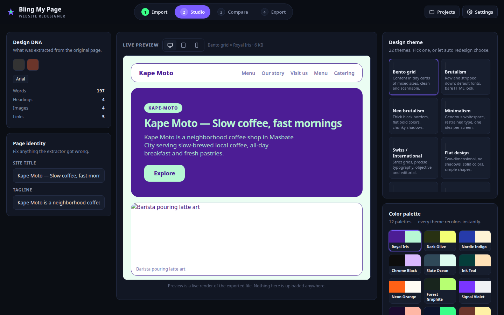
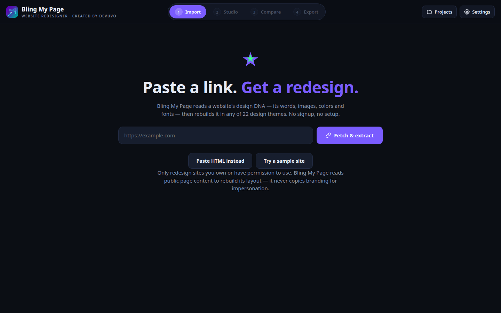

# Bling My Page

[](LICENSE)
[](https://bryan-cantila.github.io/bling-my-page/)
[](index.html)




Paste a website URL, and Bling My Page extracts its design DNA — title, headings, copy, images, colors, fonts — then lets you redesign it with 22 design themes and 12 color palettes in a live preview. One click on **Auto redesign** generates three variants (two light, one dark) with a rationale for each pick. Export the result as a standalone HTML file.

The existing tools in this category (Revamp, Repaint, Macaly, Shuffle) are all paid and none of the open-source options do URL-to-redesign end to end. Bling My Page is the free, no-signup, runs-entirely-in-your-browser version.

## How to use

1. Open the [live demo](https://bryan-cantila.github.io/bling-my-page/) — no install, no account.
2. Paste a website URL and click **Fetch & extract** (or **Try a sample site** if the target blocks fetching).
3. In the Studio, pick a theme and palette, or hit **Auto redesign** for three generated variants.
4. Preview on desktop, tablet, and phone widths; compare before/after.
5. Export: download the standalone HTML file or copy it to the clipboard.

If a site blocks fetching, use **Paste HTML instead** — copy the page source manually and extract from that.

## Features

- URL import with honest step-by-step status (fetch → parse → extract); screenshot/paste-HTML fallbacks, never faked results
- Design DNA panel: dominant colors with frequency counts, detected fonts, content statistics
- 22 design themes (bento, brutalism, neo-brutalism, minimalism, swiss, flat, material, glassmorphism, neumorphism, skeuomorphism, editorial, memphis, dark gradient mesh, monochrome, retro/Y2K, maximalism, anti-design, broken grid, scrollytelling, spatialism, organic, cyberpunk)
- 12 curated color palettes, each recoloring every theme
- Auto redesign: heuristic recommendation engine returns 3 variants with rationales + one-click re-roll; optional hook for a real LLM endpoint in Settings (heuristic is the fallback)
- Before/after comparison, device-width preview toggles
- Export review checklist (images/links carried over, contact-detail reminder)
- Named project save/load in localStorage; extensible via `BMP.registerTheme()` / `BMP.registerPalette()`

## Project structure

```
index.html   # the entire app: UI, 22 themes, 12 palettes, extractor, recommender, renderer
docs/        # screenshots
```

## Development notes

Single self-contained file, zero dependencies, system font stacks only. Extracted text is HTML-escaped before rendering (XSS-safe). Exported pages are standalone: inline CSS, absolutized images, semantic markup with title and meta description preserved.

## License

**Free to use — just credit devuvo.** Personal, educational, and non-commercial use is free, provided you give visible credit (e.g. "Created by devuvo" with a link to https://www.devuvo.com). Using it for business or income-generating purposes? Notify devuvo first at admin@devuvo.com. See [LICENSE](LICENSE) for the full terms.
